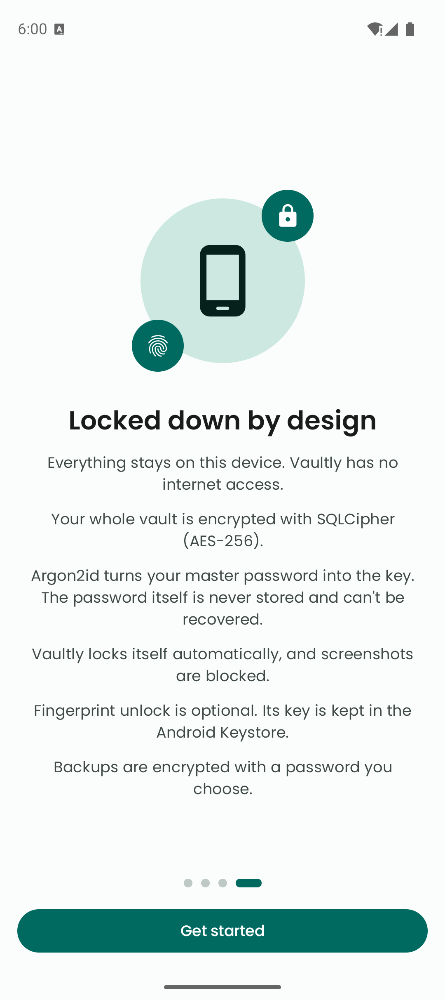
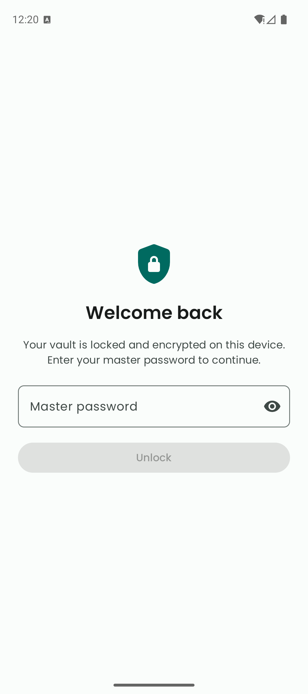
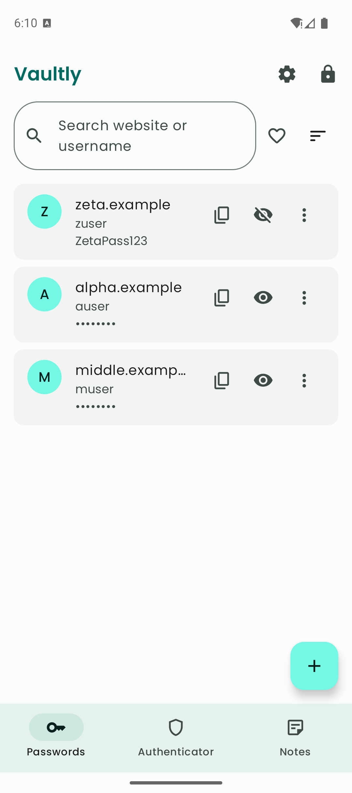
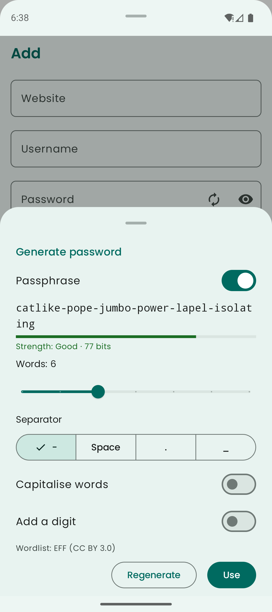
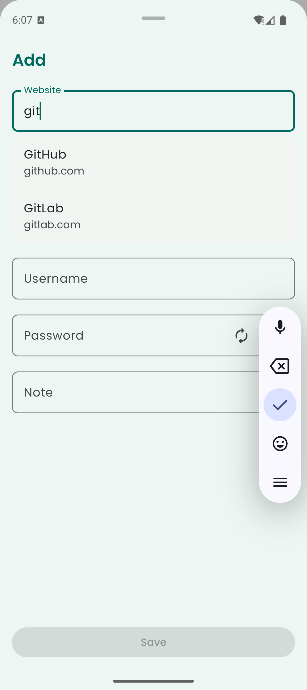
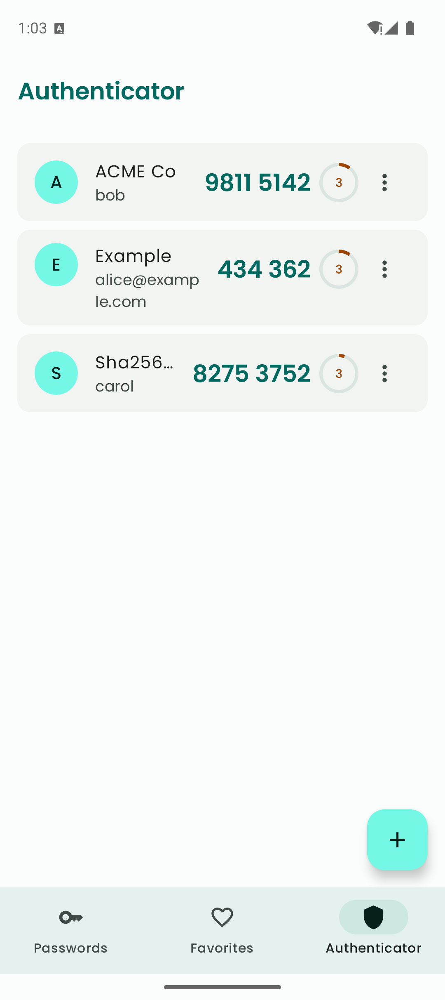
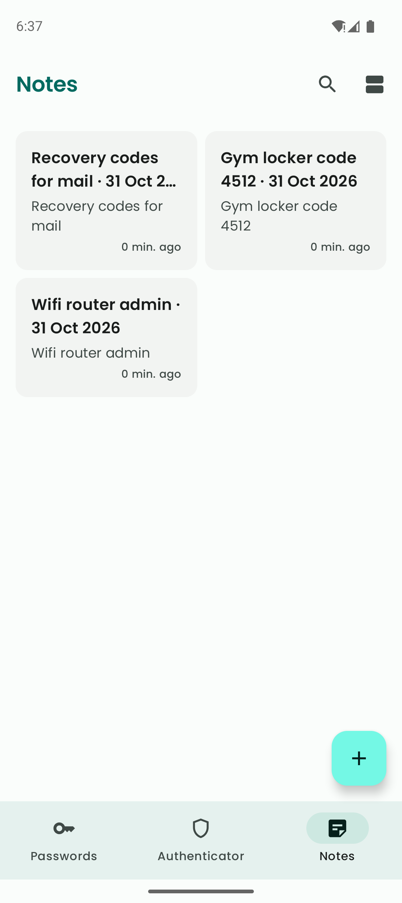
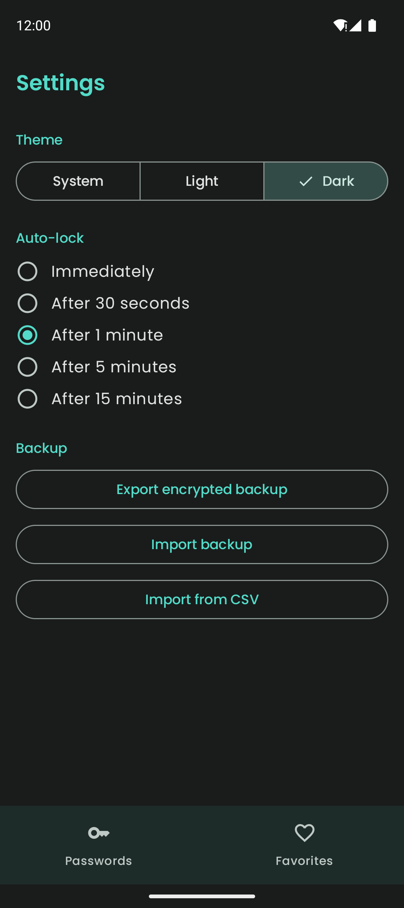

# Vaultly

Vaultly is an offline, encrypted password manager, authenticator and notes app for Android. Everything stays on your device — the app has no internet access.

## Features

### 🔒 Security
- **Encrypted vault**: The whole database is encrypted with SQLCipher (AES-256); the key is derived from your master password with Argon2id
- **Biometric unlock**: Optional fingerprint unlock, with the key kept in the Android Keystore
- **Auto-lock**: Locks on a configurable timeout (immediately to 15 minutes) and on manual lock
- **Screen protection**: Screenshots, screen recording and recent-apps previews are blocked
- **Sensitive clipboard**: Copied secrets are marked sensitive and cleared after 30 seconds
- **No cloud, no tracking**: No internet permission, no analytics, Android cloud backup disabled

### 🔑 Passwords
- Add, edit and delete with undo; search by website or username
- Favourites filter and sort options, including recently modified
- Reveal or copy passwords straight from the list
- Website suggestions from a bundled offline catalog while typing
- Password generator (length, character classes, avoid ambiguous) and word-based passphrase generator (EFF wordlist)
- Strength meter on add/edit and master-password setup

### 🛡️ Authenticator
- TOTP codes (RFC 6238; SHA1/256/512, 6 or 8 digits) with countdown and tap to copy
- Add by scanning a QR code, picking a QR image, or entering the setup key
- Import accounts from Google Authenticator's "Transfer accounts" QR

### 📝 Notes
- Encrypted notes with automatic titles
- Grid or list view, with search

### 💾 Backup and import
- Password-protected encrypted backup (Argon2id + AES-GCM) saved wherever you choose
- Import from CSV exports of Google Password Manager, Chrome and Bitwarden

### 🎨 Design
- Material 3 with light, dark and system themes
- First-run onboarding

## Screenshots

| Onboarding | Unlock | Passwords | Generator |
|---|---|---|---|
|  |  |  |  |

| Website suggestions | Authenticator | Notes | Settings (dark) |
|---|---|---|---|
|  |  |  |  |

## Privacy

Vaultly does not collect or share any data. See the [Privacy Policy](https://chahatmb.github.io/PasswordManager/privacy-policy/).

## Installation

1. Clone the repository:
```bash
git clone https://github.com/CHAHATMB/PasswordManager.git
```

2. Open the project in Android Studio

3. Build and run the app on your device or emulator

## Requirements
- Android API level 27 or higher
- Biometric hardware for fingerprint unlock (optional)

## Contributing

Contributions are welcome! Please feel free to submit a Pull Request.

## License

This project is licensed under the MIT License

## Acknowledgments

- [Room](https://developer.android.com/training/data-storage/room) - Database management
- [SQLCipher](https://www.zetetic.net/sqlcipher/) - Database encryption
- [Argon2kt](https://github.com/lambdapioneer/argon2kt) - Key derivation
- [Biometric](https://developer.android.com/training/sign-in/biometric-auth) - Fingerprint authentication
- [ZXing Android Embedded](https://github.com/journeyapps/zxing-android-embedded) - QR code scanning
- [Material Design Components](https://material.io/develop/android) - UI components
- EFF Large Wordlist for passphrases, © Electronic Frontier Foundation, [CC BY 3.0 US](https://creativecommons.org/licenses/by/3.0/us/), https://www.eff.org/dice

---

Made with ❤️ by Chahat
